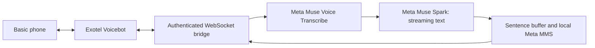

# BadaBhai

Hindi and English assistance on ordinary phones using Meta models and Exotel Voicebot. The protected web dashboard shows a live, ephemeral call transcript, source used for the PM-KISAN demo, and first-response timing. No caller number or transcript is persisted by this app.

Real incoming calls have been tested by the participant. For Windows Server 2022 setup, permanent hosting and continuing in Cursor/Codex, read [DEPLOY_WINDOWS.md](DEPLOY_WINDOWS.md) and [HANDOFF.md](HANDOFF.md).

## Call architecture



The phone path streams text into sentence-sized speech jobs. Synthesis of the next sentence overlaps playback of the current sentence. Press **9** to stop a reply, then ask a new question. Speech-triggered interruption is not yet implemented. Recognition disconnects are retried up to three times without immediately dropping the telephone socket. The default is one simultaneous call.

The dashboard at `/` authenticates with `APP_TOKEN` and can be open during an Exotel call. It shows caller transcript updates, BadaBhai reply sentences, selected language, source link/verification date, speech-end to transcript-final time, and time to first answer text, first speech preparation, first audio packet and turn completion. The server does not persist call events; the operator's browser keeps the visible transcript until the next call or the page is closed. The live view is intended for a trusted demo operator; protect it with HTTPS and a private app token.

The PM-KISAN demo uses a short source context from the official portal, reviewed on 2026-11-04. It explains general scheme information and routes personal eligibility/status questions to the official KYS route; it does not decide eligibility or ask for Aadhaar/OTP/bank PIN. Refresh the reference and verification date before relying on it after the demo.

After PM-KISAN guidance, the caller may press **3** to opt in to a short official-link SMS. The recipient number comes from Exotel's inbound call start event and is never shown in the dashboard or app logs. SMS delivery remains disabled until Exotel API credentials, an approved Sender ID, DLT Entity ID and approved Hindi/English template IDs are configured. A provider acceptance is not proof of delivery.

## Models

- Answers: Meta Model API `muse-spark-1.3` (configurable).
- Recognition: `muse-voice-transcribe-1.0`, realtime Hindi/English endpointing.
- Speech: local Meta `facebook/mms-tts-hin` and `facebook/mms-tts-eng`.

MMS has a **CC-BY-NC-4.0 noncommercial license**. Review this before commercial deployment. All AI inference uses Meta models; no OpenAI or third-party speech model is substituted.

## Local setup (Windows, Python 3.11 or 3.12)

```powershell
cd D:\Dev\BadaBhai
python -m venv .venv
.\.venv\Scripts\python.exe -m pip install -r requirements-voice.txt
```

Add your dev.meta.ai key to `.env` as `MODEL_API_KEY=...`. Never commit `.env`. On a new clone copy `.env.example` to `.env` and set a long random `APP_TOKEN`. This separate app token protects the browser test and Exotel endpoint.

Warm up the local voices (first use downloads models), then start:

```powershell
.\.venv\Scripts\python.exe -m scripts.warmup
.\start.ps1
```

Open http://127.0.0.1:8000 and enter **APP_TOKEN**, not your Meta key. Test Hindi and English text questions, then Listen to answer. Browser questions start fresh; phone calls retain six turns in memory. `/health` checks configuration only, not model access or voice readiness.

## Exotel

A temporary Cloudflare tunnel is being used for the local demo. Its complete authenticated WebSocket URL is saved in **`exotel-url.txt`**, excluded from Git. Copy that entire line into the Exotel Voicebot URL field. Do not use the browser's localhost URL. This address expires when the tunnel stops; a new tunnel gets a new hostname.

1. Test both local voices first.
2. Expose port 8000 using a TLS tunnel or server supporting long-lived WebSockets. Keep the local app running during a tunnel demo. Free hosts may sleep or lack memory for MMS.
3. Set **Call Start → Voicebot → Hangup**. Stream is one-way and cannot play replies.
4. Set Voicebot URL to `wss://YOUR-PUBLIC-HOST/exotel/YOUR_APP_TOKEN`. Never use your Meta key in this URL. Treat the complete URL as secret. Path authentication was verified after query-token connections failed in the trial account.
5. Leave recording off. Save only after the server is reachable.
6. Call Exotel directly. Press **1 for Hindi**, **2 for English**. Initial language is Hindi.
7. If streaming is rejected, ask Exotel to enable AgentStream/Voicebot on the trial and confirm its cost. Applet visibility does not prove entitlement.
8. Once direct calls work, optionally forward your spare Vi number to the Exotel number. Confirm Vi forwarding charges first.

For an audio-only test, set `CALL_MODE=echo` and restart. This repeats caller audio without Meta or voice downloads. Restore `CALL_MODE=meta` afterward.

## Current limitations

- Half-duplex for voice: wait for replies or press 9 to interrupt. Automatic interruption by speaking is not implemented.
- Five-minute limit by default; no outbound calling. Data is discarded on disconnect.
- No persistent transcript/caller-number logging by this app; authenticated dashboard events and call details are in memory only. Exotel and Meta have separate data handling policies.
- Account model access, live recognition and real telephone integration require verification with your key.
- Voice synthesis runs locally and can be slow; warm up first. Evaluate Hindi/English mixing and number pronunciation with real callers.
- Answer-generation failures play a retry prompt and keep the call open. Connection/recognition failures may still end the session; no alternate model provider is silently used.
- One simultaneous call by default; before public launch add per-caller rate limits, deployment monitoring and stronger provider authentication. This is a local hackathon prototype.
- Neither a normal Exotel number nor forwarding a Vi mobile makes calls toll-free.
- Live dashboard and scheme facts are a hackathon operator view, not an official government service. Verify current scheme details and deployment permissions before public rollout.

## Verification

```powershell
.\.venv\Scripts\python.exe -m pytest -q
```

Tests simulate provider responses; no API credits are spent.

For a deeper local test that **does use live Meta credits**, run `python -m scripts.smoke_call` with the app running. It simulates Exotel's welcome, language key and spoken question, and checks that answer audio comes back. A real carrier call must still be tested separately.

See [HACKATHON.md](HACKATHON.md) for the participation/submission checklist and why Baseten's `muse-spark-open-1026` instruction does not require changing our Meta Model API setup.

## References

- https://dev.meta.ai/docs/overview
- https://dev.meta.ai/docs/speech-to-text
- https://dev.meta.ai/docs/api-reference
- https://huggingface.co/facebook/mms-tts-hin
- https://huggingface.co/facebook/mms-tts-eng
- https://developer.exotel.com/docs/agentstream/websocket-protocol
